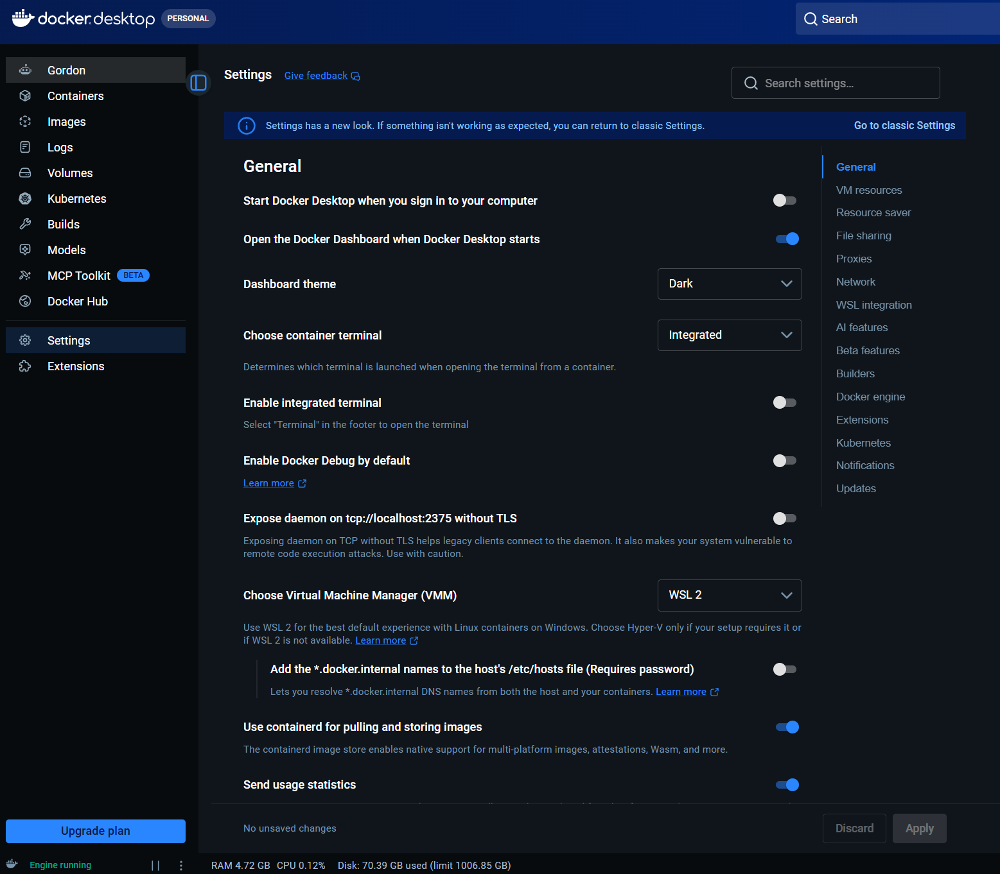

# Devcontainer setup

The devcontainer provides interactive development in a Linux Docker container
from VS Code. This repository's root `environment.yml` defines the Python
environment used by the container.

## Start Docker Desktop on Windows

Before opening the repository in the devcontainer:

1. Start Docker Desktop from the Windows Start menu and wait for the status in
   the bottom-left corner to show **Engine running**. Docker Desktop must be
   running before VS Code can build or start the container.
2. In Docker Desktop, open **Settings** and verify that **Choose Virtual
   Machine Manager (VMM)** is set to **WSL 2**. In the screenshot below, this
   setting appears in the lower half of the **General** settings page. Apply
   the setting if you changed it.



## Open the repository in the devcontainer

Open the repository folder in VS Code. If prompted, choose to reopen it in the
devcontainer. Otherwise, open the Command Palette and run **Dev Containers:
Reopen in Container**. On the first build, VS Code creates the container and
the `rqm-base` environment from `environment.yml`.

Keep `environment.yml` and the `.devcontainer` configuration in the
repository so VS Code can build the container and its environment.

## Large data (`RQM_DATA_DIR`)

When the repository is cloned on a Windows drive, the workspace is bind-mounted
over 9p, which reads at roughly 70 MB/s. The devcontainer therefore mounts a
Docker named volume, `rqm-data`, at `/data` and sets `RQM_DATA_DIR=/data/rqm`.
The volume lives on the Linux side and persists across container rebuilds.
Keep large NSI inputs, Iceberg warehouses, and exports there:

```
/data/rqm/
├── data/nsi2026_public_wkb.parquet   # nationwide NSI input
├── warehouse-notebook/               # Iceberg warehouse + catalog.db shared by the three demos (reset by 01)
├── exports-notebook/                 # analysis-ready exports (01_setup_demo.ipynb)
├── versioning-notebook/              # 02_versioning_demo.ipynb inputs/exports (recreated each run)
└── multi-source-notebook/            # 03_multi_source_demo.ipynb inputs/exports (recreated each run)
```

After the first rebuild with the volume, copy the nationwide file in once
(the source can then be removed from the Windows drive):

```bash
cp test/data/nsi2026_public_wkb.parquet "$RQM_DATA_DIR/data/"
```

`notebooks/01_setup_demo.ipynb` reads from `RQM_DATA_DIR` automatically. For the CLI,
pass volume paths explicitly:

```bash
python tools/ingest_nsi.py \
    --parquet "$RQM_DATA_DIR/data/nsi2026_public_wkb.parquet" \
    --warehouse "$RQM_DATA_DIR/warehouse" \
    --conf spark.driver.memory=8g
```
